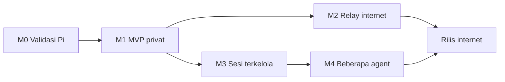

# Rencana implementasi Pi Remote Control

Membangun ekstensi `/remote-control` yang membuat sesi Pi aktif dapat dikendalikan dari HP atau browser, tanpa memisahkan percakapan terminal dan web. Produk dimulai sebagai web/PWA untuk penggunaan pribadi, kemudian berkembang ke akses internet, sesi terkelola, dan koordinasi beberapa agent.

Tanggal baseline: 17 November 2026. Implementasi lokal 0.1.0 tersedia; lihat [README](README.md) dan [status implementasi](docs/IMPLEMENTATION.md) untuk menjalankan, bukti dan gap. Milestone berikut tetap target lengkap, bukan daftar yang seluruhnya telah lulus. Angka performa, kapasitas, dan durasi perlu diuji.

## Keputusan awal

| Keputusan | Pilihan | Alasan |
| --- | --- | --- |
| Klien pertama | Web responsif dengan kemampuan PWA | Satu antarmuka untuk desktop dan HP |
| Integrasi pertama | Ekstensi attach ke proses TUI aktif | Memenuhi alur pengguna yang sudah bekerja di terminal |
| Pengelola lokal | Daemon kecil per pengguna OS | Memisahkan jaringan dan penyimpanan pengiriman dari loop Pi |
| Akses MVP | HTTPS privat melalui Tailscale Serve | Menguji pengalaman remote sebelum membangun relay publik |
| Akses internet | Relay outbound opsional pada M2 | Tidak mengharuskan pembukaan port host ke internet |
| Model | Mengikuti konfigurasi provider Pi di host | Transport remote tidak memegang kredensial model |
| Baseline Pi | 1.5.2 dengan adapter dan uji kompatibilitas | API tidak diasumsikan sama pada semua versi |
| Host pertama | Linux; macOS dan Windows setelah matriks kompatibilitas lulus | Mengurangi variasi lifecycle dan IPC saat validasi awal |
| Orchestrator awal | Pengelolaan koneksi, sesi, command, dan lease | Dibutuhkan untuk remote yang dapat dipercaya |
| Orchestrator beberapa agent | M4, opt-in, worker terisolasi | Tidak memperbesar MVP sebelum kontrol satu sesi stabil |
| Aplikasi native | Dievaluasi setelah penggunaan PWA terukur | Kebutuhan perangkat harus membenarkan biaya tambahan |

Asumsi awal: satu pemilik, perangkat pribadi, satu host pada M1, akses jaringan tersedia, dan Pi sudah dapat menjalankan pekerjaan lokal. Team collaboration, billing, marketplace, arbitrary remote shell, dan kemampuan melakukan deployment otomatis tidak masuk MVP.

## Hasil yang ingin dicapai

Pengguna menjalankan `/remote-control`, membuka QR dari HP, menyetujui perangkat melalui terminal, lalu mengirim instruksi ke sesi yang sama. Aktivitas terlihat di terminal dan web. Saat jaringan putus, draft tetap ada dan keadaan sesi dipulihkan tanpa mengirim ulang instruksi secara buta.

Keberhasilan produk dinilai dari penggunaan nyata: waktu sampai terhubung, keberhasilan handoff terminal ke HP, kejelasan antrean, pemulihan gangguan, dan kecocokan perilaku dengan Pi. Klaim lebih unggul dari Claude atau produk lain memerlukan benchmark dengan skenario dan kondisi setara.

## Urutan milestone

M3 secara teknis dapat dikerjakan setelah M1 tanpa menunggu M2. Urutan kerja default tetap M0, M1, M2, M3, M4 untuk membatasi pekerjaan paralel. M4 bukan syarat rilis beta remote.

| Tahap | Hasil utama | Batas tahap | Perkiraan satu pengembang |
| --- | --- | --- | --- |
| M0 | Bukti kontrol proses TUI yang sama | Harness lokal, belum produk publik | 2–4 hari kerja |
| M1 | PWA remote pribadi dengan autentikasi dan pemulihan | Satu host, jaringan privat, sesi attach | Tambahan 1–2 minggu |
| M2 | Akses internet melalui relay | E2EE dan pengujian distribusi klien menjadi gate | Tambahan 2–4 minggu; review keamanan dapat menambah waktu |
| M3 | Sesi managed dan beberapa host | RPC worker yang dimiliki daemon | Tambahan 2–3 minggu |
| M4 | Workflow beberapa agent dengan task DAG | Opt-in, kapasitas dan izin terbatas | Tambahan 2–4 minggu |

Perkiraan ini bukan tanggal komitmen. Alokasikan waktu terpisah bila M0 membutuhkan perubahan upstream atau M2 membutuhkan tinjauan protokol tambahan. MVP pribadi dapat dirilis tanpa menyelesaikan semua tahap.

## M0 membuktikan integrasi

| ID | Pekerjaan | Dependensi | Hasil yang dapat diperiksa |
| --- | --- | --- | --- |
| M0.1 | Catat versi Pi, Node, OS, dan revision sumber; buat fixture sesi | Tidak ada | Matriks API dan lingkungan uji |
| M0.2 | Buat ekstensi eksperimen dengan command enable dan disable | M0.1 | Registrasi dan cleanup lifecycle terbukti |
| M0.3 | Kirim prompt, steer, follow-up, dan abort dari harness | M0.2 | Semua masuk ke proses TUI yang sama |
| M0.4 | Uji capture event, snapshot, antrean, dan keadaan idle | M0.3 | Rekaman event dengan expected result |
| M0.5 | Uji reload, switch/branch, terminal lokal aktif, dan disconnect | M0.4 | Tidak ada dispatch memakai binding lama |
| M0.6 | Putuskan kemampuan korelasi command dan adapter yang didukung | M0.5 | Catatan keputusan dan batas kemampuan yang eksplisit |

Gate M0: tidak ada proses Pi kedua yang menulis sesi attach; prompt tampil di TUI aktif; output kembali ke klien; antrean dan stop mengikuti perilaku yang teruji; callback lama tidak mengirim command ke sesi baru. Jika input tidak bisa dikorelasikan secara pasti, protokol tetap menampilkan status belum terkonfirmasi. Jangan mengubahnya menjadi klaim sukses berdasarkan kemiripan teks.

Penghambat M0 harus diselesaikan sebelum memperluas UI. Pilihan penyelesaian: batasi capability secara jujur, tambahkan adapter resmi, atau ajukan perbaikan upstream. Mengganti attach menjadi sesi baru tidak boleh dilakukan diam-diam.

## M1 membangun MVP privat

| ID | Pekerjaan | Dependensi | Kriteria selesai |
| --- | --- | --- | --- |
| M1.1 | Workspace TypeScript, schema protokol, pemeriksaan CI | M0.6 | Build dan kontrak runtime tervalidasi |
| M1.2 | Daemon, IPC lokal terautentikasi, registry sesi | M1.1 | Host mengenali attach dan kehilangan koneksinya |
| M1.3 | Pairing, perangkat, grant sesi, revoke | M1.2 | Perangkat tanpa grant tidak dapat membaca atau mengontrol |
| M1.4 | Journal command dan stream event berurutan | M1.2 | Retry transport tidak membuat dispatch ganda yang diketahui |
| M1.5 | Orchestrator sesi dan lease controller remote | M1.3, M1.4 | Persaingan dua klien dan input lokal ditangani eksplisit |
| M1.6 | Web chat, tool detail, composer, status dan queue view | M1.1, M1.4 | Alur utama bisa dipakai dengan keyboard dan sentuhan |
| M1.7 | Snapshot, replay, reconnect dan draft offline | M1.5, M1.6 | Gangguan jaringan tidak membuat tampilan mengklaim state lama sebagai live |
| M1.8 | Manifest PWA, cache app shell, HTTPS privat dan panduan setup | M1.3, M1.6 | Bisa dipakai dari HP melalui tailnet |
| M1.9 | Uji end-to-end, izin, lifecycle dan dokumentasi penggunaan | M1.7, M1.8 | Gate M1 pada VALIDATION lulus |

MVP mengirim pesan teks. Lampiran, editor file, terminal web, branch mutation, dan daftar seluruh file host ditunda. Riwayat hanya mencakup sesi yang diberi akses, bukan semua sesi yang ditemukan di disk.

## M2 membangun akses internet

| ID | Pekerjaan | Dependensi | Kriteria selesai |
| --- | --- | --- | --- |
| M2.1 | Spesifikasi pairing kunci, trust model browser dan protokol E2EE | M1.9 | Pilihan library/protokol dan batas ancaman ditinjau |
| M2.2 | Relay routing, autentikasi transport, batas resource dan lifecycle channel | M2.1 | Isolasi koneksi dan penolakan resource abuse teruji |
| M2.3 | Rotasi/pencabutan kunci, reconnect dan pengujian relay bermusuhan | M2.2 | Replay dan manipulasi payload ditolak |
| M2.4 | Push opt-in tanpa isi sensitif dan alur kembali ke sesi | M2.3 | Notifikasi tidak menjadi saluran approval tanpa autentikasi |
| M2.5 | Packaging self-host, upgrade dan diagnostik teredaksi | M2.3 | Instalasi ulang tidak mencabut atau memperluas izin secara tidak sengaja |
| M2.6 | Pilot terbatas dan release gate internet | M2.4, M2.5 | Temuan keamanan kritis tertutup dan browser/perangkat nyata lulus |

Web publik harus dapat memuat app shell ketika host offline. Pada jaringan privat, app shell dilayani daemon. Pada relay internet, aset web dapat di-host terpisah; integritas rantai distribusinya masuk threat model E2EE. Tidak ada klaim relay tidak bisa membaca data jika relay juga dapat mengganti JavaScript klien tanpa batas perlindungan yang dijelaskan.

## M3 menambahkan sesi managed

| ID | Pekerjaan | Dependensi | Kriteria selesai |
| --- | --- | --- | --- |
| M3.1 | Adapter RPC dan supervisor child process | M1.9 | Startup, shutdown, crash dan stderr terpisah teruji |
| M3.2 | Pembuatan sesi, folder yang diizinkan dan worktree | M3.1 | Setiap worker memiliki sesi dan direktori kerja yang jelas |
| M3.3 | Dashboard beberapa host dan grant per host/sesi | M3.2 | Host offline tidak ditampilkan sebagai sesi selesai |
| M3.4 | Branch/tree, diff read-only dan adapter dialog yang didukung | M3.2 | Capability tidak didukung ditampilkan dengan penjelasan |
| M3.5 | Operasional managed dan uji kompatibilitas lintas OS | M3.3, M3.4 | Resume setelah restart tidak mengulang efek command yang statusnya ambigu |

Mode managed mempertahankan worker saat terminal pengguna ditutup karena daemon memiliki prosesnya sejak awal. Mode attach tidak otomatis dapat dikonversi menjadi managed. Migrasi percakapan membutuhkan proses berhenti, snapshot yang konsisten, dan alur eksplisit pada fase terpisah bila memang diperlukan.

## M4 menambahkan koordinasi beberapa agent

| ID | Pekerjaan | Dependensi | Kriteria selesai |
| --- | --- | --- | --- |
| M4.1 | Task DAG, schema hasil, batas izin dan anggaran | M3.5 | Dependency, cycle, timeout dan state invalid ditolak |
| M4.2 | Scheduler deterministik dan worker terisolasi | M4.1 | Default dua worker; task menunggu kapasitas tanpa membanjiri host |
| M4.3 | Planner sebagai pembuat usulan task | M4.2 | Usulan model tidak dapat menaikkan izin atau anggaran sendiri |
| M4.4 | Reviewer dan pemeriksaan bukti hasil | M4.3 | Review menghasilkan temuan dan bukti; bukan jaminan kebenaran |
| M4.5 | Integrasi patch, konflik dan cancel workflow | M4.4 | Tidak ada merge, reset, atau penghapusan worktree secara destruktif otomatis |
| M4.6 | Uji budget, kegagalan dependency dan pelaporan biaya | M4.5 | Tidak ada retry tak terbatas atau efek yang dilaporkan dibatalkan padahal sudah terjadi |

Orchestrator pengelola proses adalah kode deterministik. Model planner hanya mengusulkan pembagian pekerjaan. Worker Pi bukan otomatis subagent bawaan Pi; mereka adalah proses/sesi terpisah yang dibuat oleh produk ini. Rincian penjadwalan dan state ada di [ORCHESTRATOR](docs/ORCHESTRATOR.md).

## Pembagian implementasi dengan beberapa pengembang atau agent

Gunakan satu koordinator integrasi, dengan pekerjaan paralel hanya pada kontrak yang sudah disepakati. Ini alur untuk membangun produk, terpisah dari orchestrator M4 yang menjadi fitur produk.

| Peran | Kepemilikan utama | Batas pekerjaan |
| --- | --- | --- |
| Koordinator integrasi | Milestone, schema publik, dependency, acceptance | Menentukan urutan dan menyelesaikan konflik kontrak |
| Pengembang Pi | Adapter, lifecycle extension, fixture kompatibilitas | Tidak mengubah schema publik tanpa koordinasi |
| Pengembang transport | Daemon, protokol, journal, autentikasi | Tidak menganggap output model sebagai otorisasi |
| Pengembang web | PWA, tampilan state, aksesibilitas | Tidak menyimpulkan command sukses dari ACK transport |
| Reviewer | Review perubahan dan uji lintas komponen | Menilai bukti terpisah dari klaim pelaksana |

Setiap task memiliki ID, tujuan, file yang dimiliki, dependensi, larangan perubahan, kontrak input/output, dan bukti verifikasi. Hindari dua agent mengedit file yang sama secara bersamaan. Jika menggunakan worktree, setiap perubahan dibawa melalui diff yang ditinjau; jangan menyalin direktori kerja atau secret secara massal.

Setelah task selesai: pengembang menyerahkan ringkasan perilaku, diff, hasil uji, dan gap; reviewer memeriksa; koordinator mengintegrasikan lalu menjalankan tes gabungan yang relevan. Tidak perlu menjalankan ulang seluruh suite bila tidak ada perubahan atau kekhawatiran baru yang membenarkannya.

## Sumber kebenaran dan perubahan rencana

| Bidang | Dokumen yang menjadi acuan |
| --- | --- |
| Ruang lingkup dan milestone | PLAN.md |
| Perilaku yang dilihat pengguna | PRODUCT.md |
| Batas komponen dan kepemilikan data | ARCHITECTURE.md |
| State, scheduler dan lifecycle | ORCHESTRATOR.md |
| Nama field, command, event dan default transport | PROTOCOL.md |
| Trust, izin dan aturan data | SECURITY.md |
| Bukti kelulusan dan kriteria rilis | VALIDATION.md |

Perubahan yang memengaruhi beberapa bidang harus memperbarui dokumen terkait dalam perubahan yang sama. Setelah kode ada, schema runtime dan contract tests harus sama dengan protokol; setiap ketidaksesuaian adalah bug yang perlu diselesaikan, bukan alasan untuk memilih perilaku secara diam-diam.

## Risiko dan keputusan yang masih terbuka

| Risiko atau keputusan | Penanganan | Diselesaikan pada |
| --- | --- | --- |
| Korelasi input attach dengan event Pi tidak selalu pasti | Status unconfirmed/indeterminate; validasi adapter | M0 |
| Context Pi berubah setelah reload atau switch | Binding epoch dan penolakan command stale | M0 |
| Dua pengendali dan terminal mengirim instruksi bersamaan | Lease remote, serialisasi gateway, terminal tetap otoritatif | M1 |
| Tab HP disuspensi | Snapshot/replay, draft lokal, status koneksi yang jelas | M1 |
| Pilihan protokol/library E2EE dan trust distribusi web | Tinjauan khusus sebelum membuka akses internet | M2 |
| Efek tool sudah terjadi ketika worker crash atau di-abort | Rekonsiliasi, tanpa retry efek secara buta | M1 dan M4 |
| Ekstensi pihak ketiga memiliki UI atau I/O sendiri | Capability matrix; tidak menjanjikan sandbox universal | M0 dan M3 |
| Nama paket dan lisensi produk | Periksa nama dan dependency sebelum publikasi | Sebelum distribusi |
| Dukungan tim atau bisnis | Tentukan kebutuhan setelah pilot pribadi | Setelah M2 |

Biaya MVP terutama waktu implementasi, komputer host, jaringan, dan penggunaan model yang sudah dikonfigurasi pengguna. M2 menambah biaya relay, bandwidth, domain/TLS bila diperlukan, monitoring, serta distribusi push. SQLite lokal menghindari database cloud pada MVP. Anggaran nominal ditetapkan setelah jumlah perangkat, sesi, volume stream, dan pilihan hosting diketahui; tidak ada harga layanan yang diasumsikan tetap.

## Langkah eksekusi pertama

Mulai dengan M0.1–M0.3: pin lingkungan, buat ekstensi eksperimen dan harness browser lokal, lalu buktikan prompt masuk ke proses Pi aktif yang sama. Rekam bukti dengan data uji tanpa secret. Jangan menjadikan dashboard, relay publik, atau multi-agent sebagai prasyarat eksperimen ini.

Sebelum menandai M0 selesai, lengkapi semua kasus di [VALIDATION](docs/VALIDATION.md), catat API yang benar-benar didukung, dan perbarui asumsi protokol yang berubah. Semua checklist implementasi tetap belum selesai sampai ada bukti tersebut.
